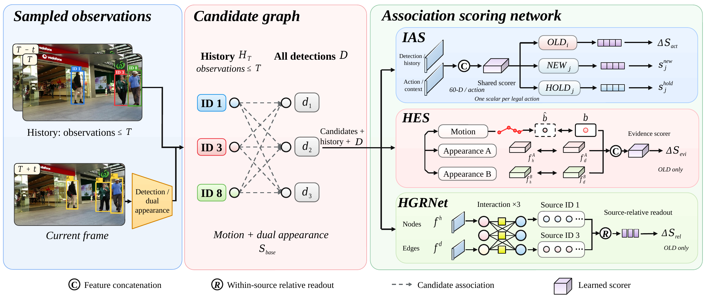

# HERA-MOT

**History-Conditioned Identity Actions for Low-Frame-Rate Multi-Object Tracking**

HERA-MOT uses motion, appearance, and track history to assign each admitted detection to an existing identity, start a new track, or withhold the detection. It commits assignments one frame at a time.

[](assets/overview.png)

## Results

### Low-frame-rate validation

| Dataset | Frame stride | HOTA | IDF1 | MOTA |
| --- | ---: | ---: | ---: | ---: |
| MOT17 | 2 | 79.75 | 89.98 | 90.61 |
| MOT17 | 5 | 78.70 | 88.78 | 89.19 |
| MOT17 | 10 | 75.87 | 84.32 | 86.01 |
| DanceTrack | 2 | 59.59 | 60.71 | 89.06 |
| DanceTrack | 5 | 52.20 | 51.78 | 84.68 |
| DanceTrack | 10 | 46.07 | 44.31 | 76.90 |

Download the [MOT17 validation checkpoint](https://github.com/SDaneil/HERA-MOT/releases/download/v0.1.0/mot17_sparse.pt) to `weights/mot17_sparse.pt` to run the `sparse_val` profile.

### Standard-frame-rate test

These are the test scores reported in the manuscript.

| Dataset | HOTA | IDF1 | AssA | MOTA |
| --- | ---: | ---: | ---: | ---: |
| MOT17 | 65.5 | 81.4 | 65.9 | 80.9 |
| MOT20 | 65.5 | 80.3 | 66.1 | 78.7 |
| SportsMOT | 82.3 | 89.9 | 77.9 | 96.8 |
| DanceTrack | 64.6 | 66.2 | 50.7 | 91.7 |


## Installation

From this directory, install the dependencies with Python 3.10 or later.

```bash
python -m pip install -r requirements.txt
```

Run a small CPU demo with synthetic detections and untrained weights.

```bash
python -m hera_mot --config configs/mot17.json --profile sparse_val \
  --stride 2 --demo --output runs/demo.txt
```

## Datasets

| Config | Profile | Strides | Split |
| --- | --- | --- | --- |
| [MOT17](configs/mot17.json) | `online_test` | 1 | Test |
| [MOT17](configs/mot17.json) | `sparse_val` | 1, 2, 5, 10 | Second half of each FRCNN training sequence |
| [MOT20](configs/mot20.json) | `online_test` | 1 | Test |
| [DanceTrack](configs/dancetrack.json) | `sparse_val` | 1, 2, 5, 10 | Official validation split |
| [DanceTrack](configs/dancetrack.json) | `online_test` | 1 | Test |
| [SportsMOT](configs/sportsmot.json) | `online_test` | 1 | Test |

## Tracking

Prepare one cache of detections and appearance descriptors per sequence, along with camera transforms between selected frames. Use the association checkpoint for the chosen profile. Data and trained weights are supplied separately. [Input format](docs/input.md)

```bash
python -m hera_mot --config configs/dancetrack.json --profile sparse_val \
  --stride 10 --input data/sequence.npz --warps data/warps-s10.npz \
  --checkpoint weights/dancetrack_sparse.pt --output runs/sequence.txt
```

The tracker runs on CPU by default. Use `--device cuda:0` for a CUDA GPU. To restore the original MOT17 frame numbers after clipping a sequence, pass the number of preceding frames as `--frame-offset`.

## Evaluation

Save one MOTChallenge-format text file per sequence named after the benchmark sequence ID. For sparse validation, keep ground-truth annotations at every selected frame, including frames with no predictions. Pass `--frame-numbering sampled` if the annotations use consecutive sampled indices. Use the benchmark's evaluation protocol to report HOTA, AssA, IDF1, and MOTA. [TrackEval](https://github.com/JonathonLuiten/TrackEval)

This package runs the shared online tracker. Reproducing the paper's scores requires the corresponding detector and appearance outputs and checkpoints. The DanceTrack and SportsMOT test runs also require the extensions described under `archived_test` in their configs.

## License

SUSHI and BoostTrack code is distributed with the inherited [SUSHI license](LICENSE) and [BoostTrack license](hera_mot/boosttrack/LICENSE) notices.
